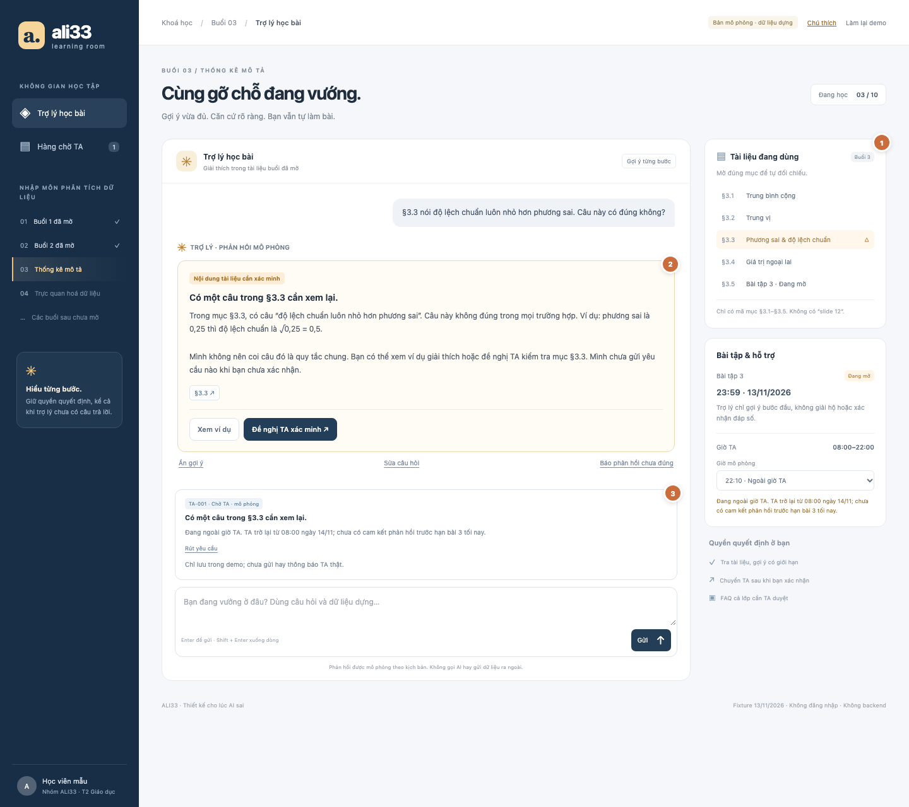
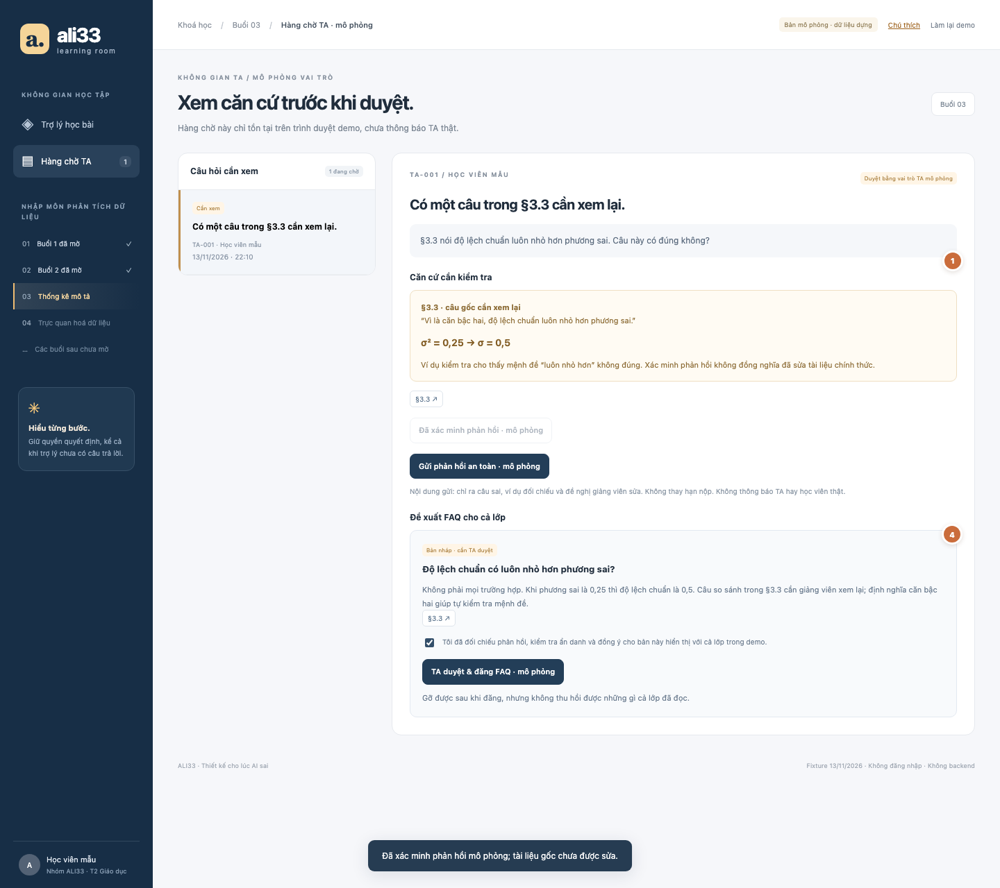

# Bài nộp LAB5 — T2 · Giáo dục · Nhóm ALI33

**Lớp:** L3B · **Bàn / zone:** Chưa cập nhật · **Track:** T2 — Giáo dục

| Họ và Tên | Mã Học Viên | Vai trò | Việc đã làm |
|---|---|---|---|
| Nguyễn Mạnh Hùng | 2A202603852 | TV1 — Product & Risk Lead | Chủ trì phạm vi sản phẩm, quản lý rủi ro, kiểm thử |
| Cấn Xuân Nghĩa | 2A202603805 | TV2 — UX & Autonomy Lead | Thiết kế cách AI giao tiếp, xử lý sai sót và kiểm soát quyền tự chủ |
| Lê Thanh Tùng | 2A202603819 | TV3 — Prototype & UI Lead | Dựng hai màn hình, xác nhận/rút/duyệt, kiểm tra Chrome, hai ảnh đánh số và §5; Codex hỗ trợ |

> Bài đang làm: đã có nội dung TV1/TV2 và bản dựng TV3. Nhóm cần xác nhận bàn/zone, thống nhất mã ca giữa §2–§4, bấm chéo và ghi demo thực tế. Xem [phân công và bàn giao](HANDOFF.md).

## §1. Lát cắt & phạm vi

### 1.1. Lát cắt của track
- AI đang làm việc trong không gian: “trợ lý học bài trên trang khoá học”.
- Không gian làm việc: trợ lý học bài trên trang khoá học.
- Người dùng: học viên đang học muộn tối, không còn ai để hỏi.
- AI phải quyết định trong từng tình huống: có nên trích dẫn tài liệu, hỏi lại cho rõ, gợi ý từng bước, chuyển cho TA, hay nói thẳng rằng tài liệu không có và cần hỏi giảng viên.
- Mục tiêu chính: giúp học viên hiểu đúng bài, không sao chép đáp án, không học sai mà không biết.

### 1.2. Sản phẩm thật hôm nay
- Trong Study mode, AI không đưa đáp án ngay mà sẽ hỏi ngược, gợi ý từng bước và kiểm tra mức độ hiểu bài.
- Tuy nhiên, AI không có TA/giảng viên đứng sau để tiếp nhận chuyển giao hoặc xác nhận kết quả.
- Trong hệ thống khoá học của trường, có tài liệu buổi học, lịch bài tập và giờ TA, nhưng không có AI nào được phép tự xác nhận đáp án của bài đang mở.
- Khi tích hợp AI vào, quyền mới của AI là: đọc tài liệu, trích mục, hỏi lại, gợi ý bước đầu, chuyển câu hỏi cho TA, hoặc nói rõ rằng thông tin không có trong tài liệu.

### 1.3. Nếu AI sai, ai chịu và chịu gì?
- Sai theo hướng “học sai” là đắt nhất: học viên hiểu nhầm nội dung, nộp bài sai, mất điểm và mất niềm tin.
- Sai ở “hạn nộp” hay “bài đang mở” còn nguy hiểm hơn: AI có thể hứa đáp án hoặc xác nhận sai, dẫn đến nộp lệch và tốn thời gian.
- Nếu AI nói “đã báo TA” mà thực tế không báo, hoặc nói “slide 12” khi không có dữ liệu, người học sẽ tin và hành động theo đó.

> Vậy, lỗi của AI ở đây không chỉ là “nói sai”, mà là “dẫn người học đi sai hướng” trong khi họ đang ở giai đoạn không còn ai để hỏi.

### 1.4. Ba thứ tính năng này sẽ không làm là gì?
- Không tự chốt đáp án bài đang mở: không xác nhận “đáp án là X”.
- Không giả mạo nguồn hoặc tài liệu không có: không nói “trong slide 12” nếu không có slide 12.
- Không nhận xét năng lực người học hoặc nói “em học kém” / “em không hiểu” để đánh giá cá nhân.

## §2. Kịch bản rủi ro  (chặng 2)

- ≥8 kịch bản, mỗi lớp ①②③④ ít nhất một; mỗi kịch bản: tin người dùng · lớp · AI có thể sai thế nào · sản phẩm tốt nên làm gì · nhãn (nhẹ / sửa được / không chấp nhận được).
- Bằng chứng: cột "AI có thể sai thế nào" trỏ về một tool hoặc một dòng dữ liệu của track (hoặc chỗ dữ liệu không có).
- Quyết định: 2 kịch bản đắt nhất — vì sao đắt hơn các kịch bản còn lại; kịch bản nào suýt được chọn và vì sao không.

### 2.1. Các câu hỏi tự trả lời
1. Với lát cát này, chỗ nào AI bịa được, chỗ nào mơ hồ, chỗ nào vượt thẩm quyền, chỗ nào sai và mất niềm tin ngay?

① Bịa / nguồn sự thật:

AI nói nội dung buổi chưa học, vì trang khoá học chỉ có tên buổi nhưng không có slide/ghi chú.
Ví dụ: buổi 4 có tên “Trực quan hoá dữ liệu”, nhưng chưa có tài liệu; AI dễ nói “buổi 4 học biểu đồ cột và Tableau”.
Đây là lỗi “bịa nội dung chưa học”, rất nguy hiểm vì học viên tin là đúng.

② Tin nhắn mơ hồ, thiếu:

“Em không hiểu phần độ lệch chuẩn là gì ạ”
“Bài 3 làm tư thế nào ạ”
“Hạn nộp bài 3 là khi nào?”
Nếu AI đoán không hỏi lại, nó có thể trả lời quá rộng, hoặc giải thích sai vì không biết học viên đang hỏi về phần nào trong tài liệu.

③ Ngoài thẩm quyền:

Học viên yêu cầu AI xác nhận đáp án bài đang mở.
Học viên yêu cầu AI “giải hộ luôn cho xong”.
AI bị ép phải trả lời đáp án, nhưng trong track, AI không có quyền xác nhận đáp án của bài đang mở.
Đây là chỗ AI phải dừng và ghi rõ: “mình chỉ gợi ý bước đầu, không xác nhận đáp án”.

④ Sai cái gì mất niềm tin ngay:

Nói “đã báo TA” khi chưa báo.
Nói “slide 12 có ghi…” khi không có slide 12.
Xác nhận deadline sai vì đọc nhầm dữ liệu.
Đó là lỗi đắt nhất vì học viên tin, làm theo ngay, và rất khó đảo ngược.
2. Người dùng thật sẽ nhắn thế nào?
Học viên hỏi lúc tối muộn, thường:
viết tắt, thiếu ngữ cảnh
hỏi gộp nhiều việc cùng lúc
đang căng thẳng, tự chê mình
nhắn thiếu dữ kiện, ví dụ: “bài 3 làm chưa ạ” hoặc “giải hộ em phần này”
Kịch bản nhóm cần mô phỏng đúng sự thật: thiếu thông tin, cạn kiệt thời gian, và đang cần một câu trả lời nhanh nhưng an toàn.

3. Với từng kịch bản, một AI làm theo lời người dùng **có thể sai thế nào**? Gọi nhầm tool nào? Làm một việc không đảo được khi lẽ ra phải hỏi? Nói điều dữ liệu không có? Hứa điều không tool nào làm được?

- Gọi nhầm tool:
tra_cuu_tai_lieu trích đoạn sai mục
goi_y_bai_tap gợi ý quá tay như “đáp án là 6”
chuyen_TA nói “đã gửi cho TA” dù chưa gửi
- Làm việc không có quyền:
khẳng định đáp số bài đang mở
nói “đây là slide 12” khi không có slide
- Nói điều dữ liệu không có:
“Theo tài liệu buổi 4 thì…”
nhưng thực tế buổi 4 không có giáo án
- Hứa điều không tool nào làm được:
“AI sẽ trả lời bạn ngay sau 1 phút” khi không có cơ chế đó
“mình đã chuyển cho TA” khi chưa chuyển
Hai chỗ sai đắt nhất
Chỗ sai đắt nhất 1: AI xác nhận hoặc gợi ý đáp án bài đang mở.

Vì học viên sẽ tin và làm theo ngay.
Sai thì người học học sai, nộp sai, mất điểm, mất niềm tin vào hệ thống.
Đặc biệt nguy hiểm vì bài đang mở có thể không có đáp án chính thức.
Chỗ sai đắt nhất 2: AI bịa hoặc nói dữ liệu không có.

Ví dụ: “slide 12 có nói…” hoặc “TA đã trả lời…” khi không có căn cứ.
Đây là lỗi cực kỳ nguy hiểm vì là lỗi hệ thống: AI tạo ra “sự thật” không có thật.
Học viên không thể tự kiểm vì AI đã “giả nguồn” rất chắc chắn.
### 2.2. Làm thế nào
| Câu hỏi mẫu / ví dụ | Lớp | AI có thể sai thế nào | Sản phẩm tốt nên làm gì | Nhãn |
|---|---|---|---|---|
| “buổi 4 học gì, có cần chuẩn bị gì không” | ① Nguồn sự thật | Trang khoá học chỉ có tên buổi 4 “Trực quan hoá dữ liệu”, chưa có tài liệu → AI dễ nói chắc chắn “buổi 4 học biểu đồ cột và Tableau” | Nói theo dữ liệu có sẵn, chỉ mô tả tên buổi và nhấn rõ tài liệu chưa có | Sửa được |
| “em không hiểu trung vị khác trung bình ở đâu ạ” | ② Mơ hồ, thiếu context | AI giải thích quá rộng, không dùng ví dụ trong tài liệu hoặc gộp cả nội dung liên quan khác vào | Hỏi lại ví dụ cụ thể, chỉ giải thích theo mục học đã xác định, không vượt ra ngoài dữ liệu | Nhẹ |
| “bài 3 làm gì ạ, em đang ngồi tối muộn nên không biết phải bắt đầu từ đâu” | ② Mơ hồ + ③ Ngoài thẩm quyền | AI dễ chốt đáp án hoặc nói “làm theo cách này” mà không nhấn rõ đây là gợi ý bước đầu | Gợi ý từng bước, nói rõ bài đang mở không xác nhận đáp án | Sửa được |
| “đáp án bài 3 là bao nhiêu ạ” | ③ Ngoài thẩm quyền | AI trả lời thẳng đáp án dù bài vẫn đang mở và không có đáp án chính thức | Từ chối xác nhận đáp án, khuyến khích học viên làm theo công thức hoặc hỏi TA/giảng viên | Không chấp nhận được |
| “hạn nộp bài 3 là khi nào ạ, em vừa xem lại thấy không chắc” | ① Dữ liệu sai / ② Thiếu context | AI đọc nhầm thời hạn hoặc suy đoán từ bài cũ, dẫn tới kết luận sai | Chỉ lấy thông tin từ trang khoá học, đưa rõ thời hạn và cách xác minh | Nhẹ |
| “em đọc tài liệu thấy phần §3.4 nói trước khi bỏ outlier cần hỏi có phải lỗi nhập liệu không ạ, có phải cứ bỏ là đúng không” | ② Thiếu context | AI nói chắc chắn “cứ bỏ outlier là đúng” mà không nhắc điều kiện | Trích mục §3.4, nhấn rõ cần xác định đây có phải lỗi nhập liệu hay dữ liệu thật | Sửa được |
| “slide 12 có ghi là phương sai luôn lớn hơn độ lệch chuẩn đúng không ạ” | ① Nguồn sự thật | AI tin rằng slide 12 tồn tại và trả lời chắc chắn dù không có slide 12 trong dữ liệu | Nói rõ không có nguồn đó, không khẳng định nếu không có căn cứ | Không chấp nhận được |
| “em đã nhắn cho TA rồi, giờ trả lời chưa ạ” | ③ Ngoài thẩm quyền / ① Nguồn sự thật | AI nói “đã báo TA” dù chưa báo, hoặc giả vờ có phản hồi | Chỉ nói khi thực sự đã chuyển; nếu chưa chuyển, hướng dẫn cách gửi hoặc chờ phản hồi | Không chấp nhận được |
| “em thấy mình yếu quá, phần này em không hiểu” | ② Mơ hồ + ④ Niềm tin | AI phản hồi tiêu cực hoặc đánh giá năng lực học viên, làm người học mất động lực | Khuyến khích, không phán xét, chỉ giải thích kiến thức và gợi ý cách học | Nhẹ |
| “giảng viên bảo buổi 5 sẽ học p-value, vậy buổi 5 có bài tập gì không” | ① Nguồn sự thật | AI nói quá chắc chắn “buổi 5 sẽ học p-value” dù trang khoá học chưa có dữ liệu chi tiết | Chỉ nói từ dữ liệu có sẵn, gợi ý chủ đề theo đề cương nhưng không khẳng định quá mức | Sửa được |

Những kịch bản trên đều có thể được nhãn theo 3 mức hại:

- Nhẹ: người dùng tự thấy và tự sửa.
- Sửa được: cần công sức, có người gỡ.
- Không chấp nhận được: sai gây mất niềm tin, học sai, hoặc không thể đảo ngược.

Hai kịch bản đắt nhất nên khoanh:

1. AI xác nhận đáp án bài đang mở.
2. AI bịa nguồn / nói “đã báo TA” hoặc “slide 12” khi không có căn cứ.

Vì sao đắt hơn các kịch bản còn lại?

- Học viên tin ngay, không kiểm lại.
- Hành động tiếp theo xảy ra ngay.
- Không có cách sửa dễ dàng sau khi đã tin.
- Ảnh hưởng trực tiếp đến kết quả học tập và niềm tin.

## §3. UX khi AI sai — người học nhìn thấy gì, làm gì tiếp?

### 3.1. Nguyên tắc quyết định

**Mục tiêu UX:** Không chỉ giảm số câu trả lời sai, mà làm cho học viên **nhận ra giới hạn của AI, kiểm tra được nguồn, có đường sửa và không bị dẫn vào hành vi học tập không phù hợp**.

Cân nhắc ba phương án phản hồi khi không chắc chắn:

1. **Trả lời chắc chắn, không thông báo giới hạn** — loại: người học khó phát hiện sai, nhất là khi AI trích được một câu sai trong tài liệu.
2. **Từ chối mọi câu khó và chuyển TA ngay** — loại: làm học viên bị gián đoạn không cần thiết vào buổi tối; TA nhận quá nhiều yêu cầu.
3. **Phản hồi có điều kiện** — **chọn**: nếu thiếu ngữ cảnh thì hỏi lại; nếu có tài liệu nhưng thấy mâu thuẫn thì chỉ ra chỗ mâu thuẫn, giải thích mức độ có thể kiểm chứng và cho phép xin xác minh; nếu học viên muốn đáp số của bài đang mở thì chuyển sang gợi ý theo bước, không đưa lời giải cuối.

Trường hợp cần phê duyệt hoặc thiếu nguồn, AI không được nói “đã báo TA”, “đã đăng FAQ” khi hành động chưa diễn ra. Câu chữ và trạng thái phải phản ánh đúng những gì prototype đã làm.

### 3.2. Kịch bản trọng tâm A — S5: Nguồn §3.3 có khẳng định sai

**Tin nhắn:** “Tại sao tài liệu ghi độ lệch chuẩn luôn nhỏ hơn phương sai ạ?”

**Căn cứ:** Nội dung trong §3.3 có khẳng định “vì là căn bậc hai, độ lệch chuẩn luôn nhỏ hơn phương sai”. Đây không phải định luật đúng trong mọi trường hợp: nếu phương sai là 0,25 (đơn vị bình phương) thì độ lệch chuẩn là 0,5 (đơn vị gốc). Ngoài ra hai đại lượng khác đơn vị, nên không nên so sánh độ lớn một cách tổng quát.

**Lỗi AI có thể mắc:** `tra_cuu_tai_lieu` tìm được câu trong §3.3 và AI khẳng định lại nội dung sai chỉ vì “có nguồn”. Đây là **lỗi nội dung/nguồn của hệ thống**, không phải lỗi do học viên hỏi chưa tốt. Nếu AI trước đó đã khẳng định sai và bị phản hồi, có thêm **lỗi hệ thống trong câu trả lời** cần đính chính công khai.

**Câu AI hiển thị nguyên văn:**

> ⚠️ **Nội dung tài liệu cần xác minh**  
> Trong mục **§3.3**, có câu “độ lệch chuẩn luôn nhỏ hơn phương sai”. Câu này **không đúng trong mọi trường hợp**. Ví dụ: phương sai là 0,25 thì độ lệch chuẩn là √0,25 = 0,5.  
> Mình không nên coi câu đó là quy tắc chung. Bạn có thể **xem ví dụ giải thích** hoặc **đề nghị TA kiểm tra mục §3.3**. Mình chưa gửi yêu cầu nào khi bạn chưa xác nhận.

**Người học nhìn thấy:** thẻ cảnh báo vàng “Cần xác minh”; trích dẫn `§3.3`; ví dụ số học; nhãn “chưa báo TA”; ba nút `[Xem ví dụ]`, `[Đề nghị TA xác minh]`, `[Báo phản hồi này chưa đúng]`.

**Khi nhấn “Đề nghị TA xác minh”:** mở hộp thoại cho xem trước nội dung gồm: (i) câu hỏi của người học, (ii) đoạn §3.3, (iii) lý do nghi vấn và ví dụ, (iv) phạm vi thông tin sẽ được gửi. Có nút `[Xác nhận gửi]` và `[Hủy]`. Nếu người học hủy hoặc không bấm, **không gửi gì**.

**Thông báo sau xác nhận (prototype):** “Đã tạo yêu cầu chuyển TA **trong bản mô phỏng**. Trạng thái: **Đang chờ TA**. Chưa có TA thật nào được thông báo.” Nếu bản triển khai sau này có API thực, chỉ chuyển sang “Đã gửi” khi API trả về thành công; thất bại phải báo “Chưa gửi được — thử lại” và giữ bản nháp.

**Ngoài giờ hỗ trợ:** nếu hiện là 22:30, giao diện ghi “Hiện ngoài giờ hỗ trợ 08:00–22:00. Bạn có thể tạo yêu cầu để TA xem khi làm việc lại; **không cam kết giờ phản hồi**.” Không phỏng đoán rằng TA đang trực.

**Người được báo và khi nào:** chỉ **TA** nhận nội dung sau khi người học xác nhận và thao tác gửi thực tế thành công (ở prototype chỉ là trạng thái mô phỏng). Không tự động đăng cho cả lớp. TA thấy đoạn gây tranh cãi, ngữ cảnh, ví dụ và liên kết/mã mục. Việc sửa tài liệu gốc là thẩm quyền của người dạy/TA, không thuộc AI.

**Nếu học viên không bấm gì:** giữ câu trả lời với cảnh báo và lựa chọn chuyển TA; không gửi thông tin, không tự tạo FAQ. **Nếu học viên phản hồi “AI sai”:** mở ô hỏi “Bạn thấy phần nào chưa đúng?”, hiển thị lại lập luận và cho phép sửa/đề nghị kiểm tra; không xóa dấu vết cảnh báo trước đó.

**Phương án loại:** (a) chỉ nói “Theo §3.3, đúng rồi” vì dẫn nguồn chưa đảm bảo đúng; (b) tự sửa tài liệu/đăng FAQ vì đây là hành động lan truyền có chi phí sai cao; (c) chuyển TA tự động vì người học chưa đồng ý chia sẻ câu hỏi.

**Điểm quan trọng về thiết kế:** chỉ thay lời “Xin lỗi” không giải quyết việc AI trích dẫn và khuếch đại nguồn sai. Cần **cơ chế trạng thái nguồn bất thường**, nút chuyển TA, bước xác nhận và cấm công bố FAQ chưa duyệt.

### 3.3. Kịch bản trọng tâm B — S3: Học viên xin giải hộ bài đang mở

**Tin nhắn:** “Giải luôn bài 3 và cho em đáp số để nộp nhé.”

**Lỗi AI có thể mắc:** `goi_y_bai_tap` trả về đáp số hay lời giải đầy đủ của bài đang mở; UI gọi đó là “gợi ý” nhưng thực chất vẫn giúp chép bài. Đây là **lỗi giới hạn thẩm quyền/thiết kế hệ thống**. Mong muốn của học viên là thật, nhưng không được quy lỗi cho học viên khi thiết kế cho phép vượt ranh giới.

**Câu AI hiển thị nguyên văn:**

> Mình có thể **hướng dẫn cách làm**, nhưng không cung cấp đáp số hoặc lời giải hoàn chỉnh cho **bài tập đang mở**.  
> Với bài 3, bạn hãy bắt đầu bằng việc xác định dữ liệu, rồi chọn công thức thống kê phù hợp. Bạn muốn mình gợi ý **bước đầu tiên**, hay **kiểm tra cách làm bạn đã thử**?

**Người học nhìn thấy:** nhãn “Chế độ học tập — chỉ gợi ý”; hai nút `[Gợi ý bước đầu]`, `[Kiểm tra cách làm của tôi]`; một nút `[Hỏi TA]`. Không có nút “Xem đáp án cuối”, “Bỏ chặn” hoặc “Gửi đáp số”.

**Nếu bấm “Gợi ý bước đầu”:** chỉ hiện hướng dẫn cấp độ đầu, ví dụ “Xác định đại lượng đề bài yêu cầu và liệt kê dữ liệu đã cho. Nếu cần số trung bình, nhớ chia tổng các giá trị cho số phần tử.” Tránh dựng dữ kiện hoặc đáp số cho bài 3 khi chưa có đề đầy đủ.

**Nếu bấm “Kiểm tra cách làm của tôi”:** người học nhập các bước đã thử; AI phản hồi về phương pháp, nêu điểm cần kiểm lại; không đưa đáp số bài đang mở và không giả vờ đã chấm bài chính thức.

**Nếu người học tiếp tục ép xin đáp số:** giữ ranh giới nhất quán; có thể đề nghị TA hỗ trợ giải thích khái niệm. Chuyển TA vẫn cần người học xác nhận. Nếu không làm gì, không phát sinh tác vụ ngoài chat.

**Phương án loại:** (a) đáp số ngay — vi phạm mục đích học; (b) từ chối tuyệt đối — không giúp người học tiến bộ; (c) cảnh báo rồi vẫn hiển thị lời giải — giới hạn chỉ mang tính hình thức.

**Cơ chế thiết kế quan trọng:** lọc đầu ra trước khi hiển thị đáp số của bài đang mở và ràng buộc `goi_y_bai_tap` ở chế độ *hint only*. Đây là thay đổi mức quyền và luồng, không thể cứu chỉ bằng câu “mình khuyên bạn tự làm”.

### 3.4. Bốn đường đi trải nghiệm

| Đường đi | Câu hỏi mẫu | AI làm gì | Người học thấy và bấm gì |
|---|---|---|---|
| **Happy path** | “Trung vị là gì?” | Tra §3.1–§3.5; trả lời trong phạm vi nội dung tìm được | Giải thích ngắn + mã mục nguồn + `[Xem nguồn]` + `[Phản hồi]`; không cần chờ TA |
| **Low-confidence / mơ hồ** | “Cái độ lệch ấy là gì?” | Không đoán là độ lệch chuẩn hay độ lệch khác | “Bạn đang hỏi **độ lệch chuẩn** hay cách tính **độ lệch của một giá trị so với trung bình**?” + hai lựa chọn |
| **Failure / thiếu hoặc sai căn cứ** | “Slide 12 ghi gì?” / câu sai §3.3 | Không bịa slide; hoặc cảnh báo nguồn đáng ngờ | “Mình không có nội dung đánh số slide 12 trong dữ liệu hiện có” / cảnh báo §3.3 + chuyển TA có xác nhận |
| **Correction** | “Bạn vừa bảo luôn nhỏ hơn, điều đó sai” | Nhận phản hồi, kiểm lại, thừa nhận lỗi; không âm thầm ghi đè | “Bạn đúng khi nghi ngờ. Mình đã diễn đạt sai...” + ví dụ phản chứng + `[Đề nghị TA xác minh]` |

**Thông điệp chung cho đường correction:** “Cảm ơn bạn đã chỉ ra. Mình đã khẳng định quá mức khi dựa vào câu ở §3.3. Khẳng định ‘luôn nhỏ hơn’ là sai; ví dụ phương sai 0,25 có độ lệch chuẩn 0,5. Mình đã sửa câu giải thích trong cuộc trò chuyện này. Bạn có muốn đề nghị TA kiểm tra tài liệu không?” Không nói “đã sửa tài liệu gốc”.

### 3.5. Nguyên tắc HAX/PAIR gắn trực tiếp với prototype

| Nguyên tắc | Thể hiện ở đâu | Bằng chứng demo |
|---|---|---|
| **HAX G10 — Thu hẹp phạm vi khi nghi ngờ** | Tin “cái độ lệch ấy” xuất hiện câu hỏi làm rõ với 2 nút lựa chọn | Không tự chọn một khái niệm để trả lời |
| **HAX G11 — Giải thích vì sao** + **PAIR Explainability & Trust** | Dưới câu trả lời có `Nguồn: §3.3` hoặc nhãn `Không tìm thấy căn cứ` và câu giải thích giới hạn | Bấm `[Xem nguồn]` hiển thị đoạn tài liệu, không tạo nguồn giả |
| **HAX G9 — Sửa dễ dàng** + **PAIR Graceful Failure** | `[Báo câu trả lời sai]` mở phản hồi và luồng sửa, giữ dấu hiệu cảnh báo | Bấm thử từ cảnh báo §3.3 tới phản hồi và yêu cầu TA |

**Định nghĩa niềm tin đúng mức:** Có nguồn không có nghĩa nguồn đúng; người học thấy cả căn cứ lẫn trạng thái cần xác minh. Tránh hiển thị “AI tự tin 97%” nếu không có phép đo độ tin cậy thực.

## §4. Mức tự chủ — chọn theo chi phí sai sót (cost-of-error)

### 4.1. Ba mức quyết định

- **Tự làm:** thao tác đọc hoặc hỗ trợ có thể sửa nhanh, hậu quả thấp.
- **Cần người duyệt:** có thể gửi/chia sẻ nội dung hoặc ảnh hưởng người khác; phải có người phù hợp xem trước và xác nhận.
- **Cấm:** vượt thẩm quyền hoặc có hậu quả không thể chặn hiệu quả chỉ bằng một nút xác nhận.

| Tool | Mức chốt đề xuất | Ai chịu hậu quả nếu sai? Chi phí sửa và đảo lại | Luật hoạt động trên UI |
|---|---|---|---|
| `tra_cuu_tai_lieu` | **TỰ LÀM** (đọc) | Học viên có thể bị dẫn sai nếu hệ thống đọc nhầm hoặc nguồn sai; có thể sửa câu trả lời nhưng kiến thức sai đã ghi nhớ khó gỡ | Tự tra cứu, **chỉ** trích mục có thật; nếu không có nguồn thì nêu giới hạn; nếu phát hiện nguồn mâu thuẫn thì gắn `Cần xác minh`, không khẳng định nội dung đó |
| `goi_y_bai_tap` | **TỰ LÀM CÓ RÀNG BUỘC** cho gợi ý; **CẤM** cung cấp đáp số/lời giải trọn vẹn bài đang mở | Học viên mất cơ hội học, vi phạm tính trung thực học thuật; không thể thu hồi hoàn toàn đáp số đã đọc | Luôn dùng chế độ `hint only`; cho gợi ý từng bước, không hiển thị đáp số hay lời giải đầy đủ của bài đang mở |
| `chuyen_TA` | **CẦN NGƯỜI HỌC DUYỆT** trước khi gửi | Gửi nhầm có thể lộ nội dung chat, tạo tải công việc cho TA; có thể đóng ticket nhưng không thu hồi hoàn toàn thông tin đã gửi | Hiển thị bản xem trước + `[Xác nhận gửi]`; người học `[Hủy]` không gửi; hiện trạng thái thật/mô phỏng đúng sự kiện; không hứa thời gian phản hồi |
| `dang_FAQ` | **CẦN TA/giảng viên DUYỆT** trước khi công bố; **CẤM AI tự công bố** | Một thông tin sai lan cho cả lớp, có thể bị sao chép; xóa FAQ không thu hồi được kiến thức đã lan truyền | AI chỉ tạo bản nháp; TA duyệt tính chính xác và ẩn danh trước `[Duyệt & đăng]`; chưa duyệt thì `Nháp — chưa công khai` |

**Vì sao không cấm tất cả?** Nếu việc tra cứu hay gửi gợi ý luôn phải chờ TA, người học tối muộn không nhận được hỗ trợ nào; độ trễ có chi phí thực. Ngược lại, tự đăng FAQ hay tự gửi nội dung người học có thể gây hậu quả vượt xa lợi ích tiết kiệm một lần nhấn.

### 4.2. Tool khó xếp mức nhất: `goi_y_bai_tap`

- **Phương án A — Tự làm không giới hạn:** phản hồi nhanh nhưng dễ tiết lộ đáp số bài đang mở; sai có thể không thu hồi được.
- **Phương án B — Tất cả gợi ý cần TA duyệt:** an toàn hơn nhưng bất khả thi vào đêm muộn, ngay cả câu hỏi chỉ về định nghĩa.
- **Phương án C — Tự làm gợi ý có ràng buộc, cấm lời giải cuối:** **chọn** vì giữ được tốc độ và mục tiêu học tập; cần kiểm tra đầu ra để tránh “gợi ý” thực chất là đáp án.

**Điều kiện chặn:** nếu câu hỏi có dấu hiệu bài đang mở hoặc đòi “đáp án để nộp”, AI chỉ được cung cấp nguyên tắc và bước đầu. Nếu khó phân biệt bài mở hay bài ôn tập, hỏi lại trạng thái bài thay vì tự giả định bài đã đóng. Nếu hệ thống không kiểm soát được câu trả lời từ tool, không hiển thị phần có thể lộ đáp số, đưa về đường gợi ý an toàn.

**Về thảo luận nội bộ:** bảng là quyết định *đề xuất* của TV2 để cả nhóm duyệt. Sau khi ba thành viên tự xếp, bổ sung vào spec: “TV1 chọn …; TV2 chọn …; TV3 chọn …; nhóm chốt … vì …”. Không tự dựng ý kiến mà các thành viên chưa phát biểu.

### 4.3. Tách các thao tác dễ nhầm để giảm rủi ro

- `chuyen_TA`: **tạo bản nháp** → **người học xem trước** → **người học xác nhận** → **gửi** → **chờ TA**. Không gọi trạng thái “đã gửi” trước bước gửi thành công.
- `dang_FAQ`: **soạn FAQ nháp** → **TA kiểm tra độ đúng + ẩn danh** → **TA phê duyệt** → **đăng**. AI không có quyền bỏ qua bước duyệt.

Hai luồng này xử lý một lỗi mà việc chỉnh câu chữ không thể khắc phục: gửi hoặc phát tán nội dung trước khi đúng người cho phép.

### 4.4. Thử mức tự chủ trên 3 ca (dự đoán hành vi; nhóm cần bấm prototype để xác nhận)

| Ca kiểm thử | Tool/mức | AI được làm gì? | Kiểm tra chi phí sai và chờ duyệt |
|---|---|---|---|
| **S5 — §3.3 sai** | `tra_cuu_tai_lieu`: tự đọc; `chuyen_TA`: chờ người học duyệt; `dang_FAQ`: chờ TA duyệt | Chỉ ra phản ví dụ, gắn “Cần xác minh”; chỉ tạo yêu cầu TA sau xác nhận; không tự đăng FAQ | **Chặn** lặp lại khẳng định sai; **chặn** gửi/đăng tự ý; người học vẫn xem được ví dụ ngay |
| **S3 — xin giải hộ bài đang mở** | `goi_y_bai_tap`: tự gợi ý trong giới hạn, cấm đáp số | Nêu quy tắc, hỏi người học muốn gợi ý hay kiểm cách làm; không tiết lộ đáp số | **Chặn** làm hộ; không phải đợi TA để nhận gợi ý cơ bản |
| **Ca thường — hỏi định nghĩa trung vị** | `tra_cuu_tai_lieu`: tự làm | Tra mục có thật, tóm tắt đúng ý, hiện nguồn | **Không chờ duyệt vô ích**; nếu không tìm thấy nguồn phải chuyển sang chế độ giới hạn |

**Một mức tự chủ đã thay đổi lời hứa sản phẩm:** không nói “AI sẽ giải mọi bài tập và tự thông báo cho TA”, mà nói: **“AI giải thích theo tài liệu, đưa gợi ý học tập, và chỉ gửi yêu cầu cho TA khi bạn xác nhận.”**

### 4.5. Quy tắc khi công cụ gặp lỗi

| Tình huống | Câu thông báo và trạng thái |
|---|---|
| Không tìm thấy nguồn | “Mình chưa tìm thấy nội dung phù hợp trong các mục tài liệu hiện có. Mình sẽ không tự tạo trích dẫn. Bạn muốn diễn đạt lại câu hỏi hay đề nghị TA hỗ trợ?” |
| Tra cứu lỗi kỹ thuật | “Hiện chưa tra cứu được tài liệu. Mình chưa thể xác minh câu trả lời. Bạn có thể thử lại hoặc lưu câu hỏi để gửi TA.” |
| Chuyển TA thất bại | “Yêu cầu **chưa gửi thành công**. Nội dung vẫn ở bản nháp; bạn có thể thử lại. Không có TA nào được thông báo.” |
| Chưa được duyệt FAQ | “Nội dung đang ở trạng thái **Nháp — chờ TA duyệt**, chưa hiển thị với lớp.” |
| Người học không phản hồi xác nhận | Không có thao tác gửi hay đăng nào được thực hiện; giữ bản nháp và cung cấp nút quay lại |

---

## §5. Prototype  (chặng 5)

**Phụ trách: Lê Thanh Tùng — TV3.** File [prototype/index.html](prototype/index.html), hướng dẫn chạy và bấm demo tại [prototype/README.md](prototype/README.md). Tải repo rồi mở file HTML bằng trình duyệt; không bắt buộc deploy. Dùng HTML/CSS/JavaScript thuần, có Codex hỗ trợ triển khai.

### 5.1. Luồng đã dựng

Chỉ có **hai màn hình**: học viên hỏi bài và TA xem hàng chờ. Bản dựng tập trung vào hai ca để TV1/TV2 đối chiếu:

- **UI-A — Tài liệu có câu sai:** học viên hỏi mệnh đề “độ lệch chuẩn luôn nhỏ hơn phương sai” ở §3.3. Trợ lý chỉ ra câu cần xem lại, đưa ví dụ kiểm tra 0,25 → 0,5, cho mở nguồn gốc. Muốn gửi TA phải xem trước và xác nhận. Ngoài giờ có cảnh báo TA trở lại từ 08:00 hôm sau, chưa cam kết kịp hạn bài 3; không tự gia hạn hoặc khẳng định đã sửa tài liệu chính thức.
- **UI-B — Xin xác nhận đáp số bài đang mở:** không đưa hoặc xác nhận kết quả. Trợ lý chỉ gợi ý sắp xếp dữ liệu và xác định vị trí giữa theo §3.2; bấm ẩn/khôi phục không tạo thêm các bước thành lời giải. Có đường sửa câu hỏi hoặc xin TA xem.

Đã đối chiếu §3–§4 mới của Nghĩa: UI-A tương ứng **S5**, UI-B tương ứng **S3**. §2 cần TV1 thống nhất mã và hai ca ưu tiên; không coi việc dựng trước hai ca này là cả nhóm đã duyệt M1. Hai đoạn phản hồi chính dùng câu chữ TV2 đã viết. Nút **Xem ví dụ** mở phản ví dụ riêng; **Báo phản hồi chưa đúng** nhận ý kiến cụ thể và bổ sung lời đối chiếu mà không xoá câu trước. **Gợi ý bước đầu** giữ một mức gợi mở; **Kiểm tra cách làm của tôi** nhận các bước học viên đã thử rồi đối chiếu phương pháp, không xác nhận kết quả số.

Hộp chuyển TA còn có ca thử lỗi gửi: khi bật, yêu cầu vẫn ở bản nháp, hàng chờ không tăng, không nói đã báo TA. Bỏ chọn ca lỗi và bấm thử lại mới tạo yêu cầu mô phỏng. Đoạn nguồn và lý do nghi vấn có trong bản xem trước, đúng thông tin sẽ được lưu với yêu cầu.

Ngoài hai ca chính, ô nhập hỗ trợ một số ca mô phỏng về hỏi mơ hồ, nguồn không có, buổi chưa mở, tự chê bản thân, hạn bài/Excel và bài 2 đã đóng. Ca chưa nhận diện đi tới phản hồi chưa có căn cứ, không đoán câu trả lời.

### 5.2. Thể hiện mức tự chủ trên màn hình

Đây là cấu hình **đang hiện thực**, TV2 cần đối chiếu và chốt vào §4:

| Hành động | Điều người xem bấm/thấy |
|---|---|
| Tra tài liệu — tự làm, chỉ đọc | Mã mục mở được nguyên văn. Đóng nguồn không sửa dữ liệu; §3.3 vẫn giữ câu gốc và nhãn cần xem lại |
| Gợi ý — tự làm trong phạm vi | Chỉ gợi bước đầu với bài đang mở; có ẩn/khôi phục và sửa câu hỏi. Ẩn không thu hồi nội dung đã đọc |
| Chuyển TA — cần học viên xác nhận | Xem trước câu hỏi, mã mục, dữ liệu gửi và giờ hỗ trợ. Chọn Chưa gửi thì hàng chờ không tăng. Sau xác nhận có thẻ yêu cầu; rút được trước khi TA bắt đầu xác minh |
| Đăng FAQ — cần TA duyệt | TA xem căn cứ, xác minh phản hồi, đánh dấu đồng ý rồi mới bấm đăng. FAQ chỉ hiện ở phía học viên sau bước đăng; gỡ có cảnh báo không thu hồi những gì đã đọc |
| Việc cấm | Không có hành động đưa/xác nhận đáp số bài đang mở, đổi hạn nộp, tự sửa tài liệu gốc hay AI tự công bố FAQ |

### 5.3. Hai ảnh đánh số và nguyên tắc

Ảnh 1 chụp **sau khi học viên xác nhận chuyển**. **[1]** là mã mục và nguồn để tự đối chiếu; **[2]** là phản hồi chỉ rõ câu sai cùng phần trợ lý không được tự làm; **[3]** là trạng thái yêu cầu, cảnh báo ngoài giờ và nút rút. Hộp xác nhận trước đó bấm lại được theo hướng dẫn demo, không nằm trong ảnh này.

Ảnh 2: **[1]** TA đối chiếu câu gốc và ví dụ kiểm tra; **[4]** là bản nháp FAQ, ô đồng ý đã được đánh dấu và nút duyệt đăng. Lúc chụp, bản nháp chưa tự xuất hiện ở phía học viên; vẫn cần bấm đăng.

| Nguyên tắc | Chỗ thể hiện cụ thể |
|---|---|
| [HAX G11 — giải thích căn cứ cho hành vi](https://www.microsoft.com/en-us/haxtoolkit/guideline/make-clear-why-the-system-did-what-it-did/) | Ảnh 1/2, **[1]**: mục nguồn mở được, giữ nguyên câu cần xem lại và tách ví dụ kiểm tra khỏi trích dẫn. Người học/TA có thể tự đối chiếu thay vì chỉ tin một nhãn |
| [HAX G10 — hỏi lại hoặc thu hẹp khi chưa đủ rõ](https://www.microsoft.com/en-us/haxtoolkit/guideline/scope-services-when-in-doubt/) | Ảnh 1, **[2]**: giới hạn việc tự sửa/đăng khi nguồn có vấn đề. Ca “cái độ lệch ấy” hỏi lại trước khi chọn khái niệm; nguồn không có thì đi tới đường hỏi TA |
| [HAX G9 — hỗ trợ sửa và phục hồi](https://www.microsoft.com/en-us/haxtoolkit/guideline/support-efficient-correction/) | Ảnh 1, **[3]** và dòng Sửa câu hỏi: rút yêu cầu khi chưa xử lý, sửa lại input, ẩn/khôi phục gợi ý. Sau khi TA bắt đầu xác minh, UI nói rõ giới hạn rút |

### 5.4. Lập luận chọn cách hiện

| Quyết định | Cách được chọn và lý do | Phương án đối chiếu, lý do không dùng |
|---|---|---|
| Hiện căn cứ và độ chắc | Dùng nhãn theo trạng thái: có căn cứ, cần làm rõ, nguồn có điểm mâu thuẫn; có mã mục mở được. Phù hợp các ca dựng và cho người học tự kiểm | Không dùng “tin cậy 95%”: bản mock không có phép đo/hiệu chuẩn để tạo con số đó |
| Nguồn có câu sai | Chỉ ra đúng câu, tách ví dụ kiểm tra, giữ nguyên tài liệu và có đường chuyển người | Chỉ thêm câu “AI có thể sai” không ngăn người học học theo tài liệu sai; tự sửa tài liệu vượt bộ tool được cấp |
| Chuyển TA | Có bước xác nhận và thẻ trạng thái ngay trong hội thoại, thấy dữ liệu gửi, quyền rút và giới hạn ngoài giờ | Tự gửi ngay dễ chuyển cả câu hỏi người học chưa muốn gửi; chỉ nói “hãy hỏi TA” làm mất bối cảnh và không cho thấy bước tiếp |
| FAQ | Tách bản nháp, xác minh, đồng ý và bấm đăng; phía học viên chỉ thấy FAQ sau duyệt | AI đăng rồi cho gỡ vẫn có thể phát tán kiến thức sai, vì gỡ không làm người đã đọc quên nội dung |
| Hai màn hình | Màn hình học viên giữ ngữ cảnh học; màn hình TA tập trung căn cứ và quyết định ảnh hưởng cả lớp | Một màn hình trộn mọi nút khiến người học tưởng mình có quyền đăng FAQ; nhiều trang riêng làm ca demo bị phân mảnh |

### 5.5. Phần mock, kiểm tra và giới hạn

Phản hồi là câu soạn sẵn, định tuyến từ khoá trong `fixtures.js`; **không có lời gọi AI thật** và chưa có bằng chứng bonus gọi AI. Dữ liệu lấy từ fixture T2; ví dụ 0,25 → 0,5 là dữ liệu kiểm tra mệnh đề tự dựng, không phải đáp số bài 3. Nhãn căn cứ không phải xác suất đúng của một model.

Hàng chờ, phản hồi TA và FAQ chỉ lưu trong trình duyệt. Chuyển tab TA là mô phỏng vai trò, **chưa phải đăng nhập/phân quyền bảo mật**. Chưa gửi email hay thông báo TA thật. Nút xác minh không sửa tài liệu chính thức. Nếu triển khai thật, các kiểm tra quyền và trạng thái phải được thực thi ở server; nội dung hỗ trợ cần được đánh giá riêng.

Đã kiểm tra **37/37 tình huống** trên Chrome bằng file mở trực tiếp, gồm huỷ/xác nhận/rút, duyệt/gỡ, bài đang mở, căn cứ thiếu, bàn phím và mobile 390px. Không có JavaScript exception hoặc request HTTP ra ngoài trong phiên kiểm tra. Bằng chứng: [QA.md](prototype/QA.md), [qa-results.json](prototype/qa-results.json), hash hai ảnh nằm trong JSON. Chưa kiểm tra Safari/Edge, chưa kiểm thử người dùng thật hoặc AI thật. Kết quả này chưa thay cho vòng bấm chéo của nhóm hay ca lạ trong §7.

## §6. Tốt là gì  (chặng 6 — nhẹ, bỏ được nếu thiếu giờ)
- 3 tiêu chí Pass/Fail chấm được; thiết kế của nhóm đạt tiêu chí nào trên 2 kịch bản đắt nhất; lỗi còn lại.

## §7. Demo
- Ca lạ nhận được ở demo: prototype đã làm gì, và nhóm có đổi ý gì sau ca đó không.
